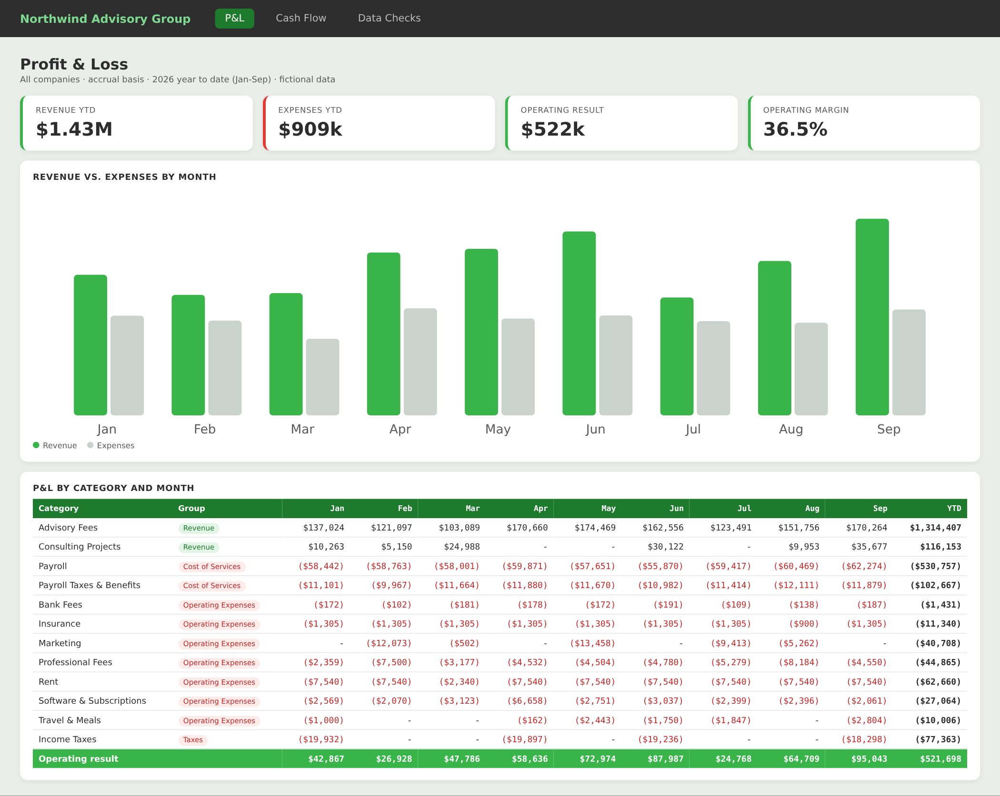
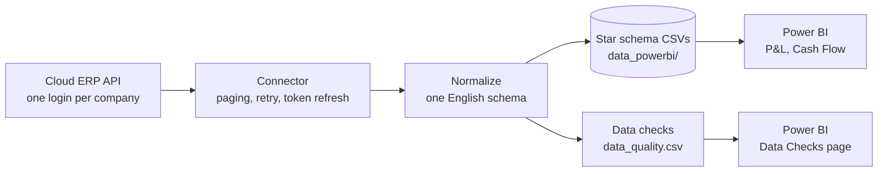
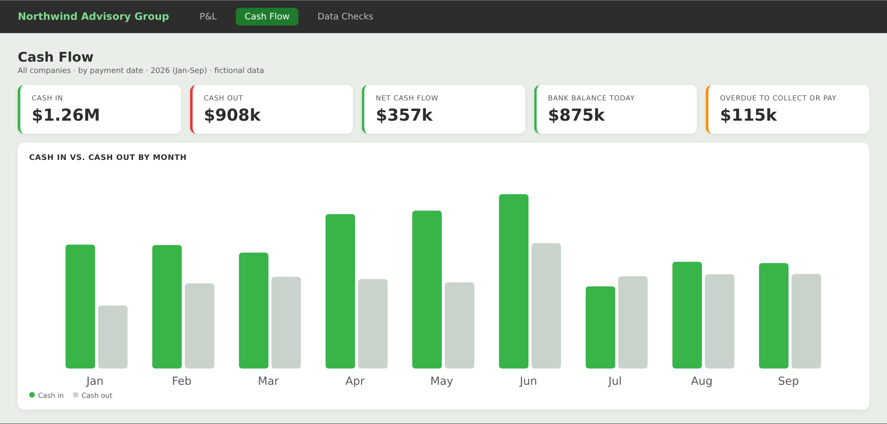
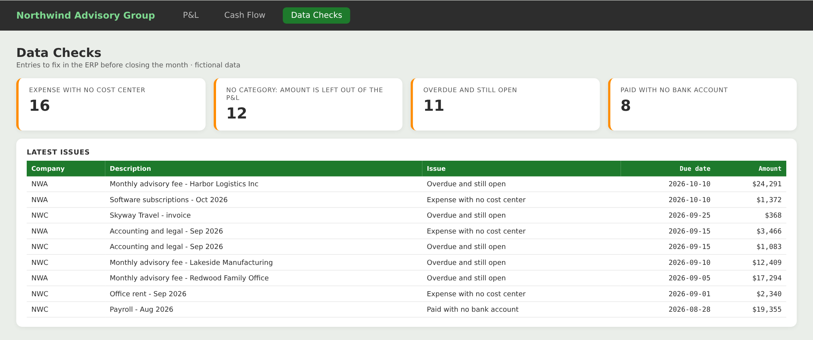

# ERP to Power BI Pipeline

[](https://github.com/FabioFerreiraFSF/erp-to-powerbi-pipeline/actions/workflows/tests.yml)  

**From ERP to a refreshed P&L and cash flow dashboard in one command.** This Python pipeline pulls receivables, payables, the chart of accounts, cost centers and bank accounts from a cloud ERP. It turns them into a clean star schema for Power BI and lists the bookkeeping errors to fix before anyone trusts the numbers.



> This is a cleaned, generic version of a pipeline I run in production for a group of companies, built on the Conta Azul API. All companies, people and numbers in this repository are fictional.

## The problem

Most small and mid-size companies run their finances in a cloud ERP, but the ERP's own reports are rigid. The usual workaround is to export spreadsheets every month, paste them into Excel, fix the categories by hand and rebuild the P&L. With several companies in a group, that means several exports, several files and plenty of room for error. And when an entry has no category or no bank account, the report is wrong and nobody notices.

## What it does

| Step | Detail |
| --- | --- |
| 1. Extract | Reads every company of the group through the ERP's REST API (OAuth 2.0, read-only), with paging and automatic retry when the API is busy. |
| 2. Normalize | Maps the ERP's fields to one English schema, so all companies land in the same tables. |
| 3. Load | Writes a star schema as CSV files: one fact table of transactions plus category, cost center, bank account, company and date dimensions. |
| 4. Check | Flags entries that would distort the report: no category, expenses with no cost center, payments with no bank account, no customer or vendor, overdue items. |
| 5. Report | Power BI reads the folder. Click **Refresh** and the P&L, cash flow and data checks pages update. |



## The dashboard

| Cash Flow | Data Checks |
| --- | --- |
|  |  |

These previews are rendered from the sample data by `scripts/render_preview.py`. The Power BI model behind them (relationships, Power Query loader and DAX measures) is in [`powerbi/`](powerbi/).

## Try it in 1 minute (no ERP account needed)

```bash
git clone https://github.com/FabioFerreiraFSF/erp-to-powerbi-pipeline.git
cd erp-to-powerbi-pipeline
pip install -r requirements.txt
python -m pipeline --demo
```

The demo uses a fake ERP with two companies of the fictional **Northwind Advisory Group**, from January 2024 to December 2026. A fixed random seed makes every run identical. A few bookkeeping errors are planted on purpose, so the data checks have something to find:

```
Data quality (share of entries with the field filled in):
  category                   98.9%
  cost center (expenses)     97.6%
  bank account (paid)        99.2%
  counterparty              100.0%
Issues to fix in the ERP: 8 missing_bank_account, 12 missing_category, 16 missing_cost_center, 11 overdue
```

Then point Power BI at the `data_powerbi/` folder (see [`powerbi/README.md`](powerbi/README.md)), or build the HTML preview with `python scripts/render_preview.py`.

## Use it with Conta Azul

1. Create an app in the Conta Azul developer portal and register the redirect URL `http://127.0.0.1:5000/callback`.
2. Copy `companies/EXAMPLE.json.example` to `companies/<CODE>.json` (one file per company) and fill in the client ID and secret.
3. Log in once per company: `python -m pipeline.auth <CODE>`. The browser opens, you approve, and the tokens are saved in `tokens/`.
4. Run `python -m pipeline` (all companies) or `python -m pipeline --company <CODE>`.

Settings such as the output folder and how many months to export are in `.env` (see `.env.example`).

## Add another ERP

Every data source is a small connector class with four methods: `transactions()`, `categories()`, `cost_centers()` and `accounts()` (see [`pipeline/connectors/base.py`](pipeline/connectors/base.py)). The export, the data checks and the Power BI model stay the same, so supporting QuickBooks Online, Xero or another ERP means writing one new file.

## Security

- Read-only access to the ERP. The pipeline never creates or changes entries.
- The OAuth callback listens on `127.0.0.1` only, checks the `state` value, and never prints the authorization code.
- Credentials (`companies/*.json`), tokens (`tokens/`), `.env` and exported data (`data_powerbi/`) are in `.gitignore` and never leave your machine.
- TLS certificates are always verified.

## Project layout

```
pipeline/
  __main__.py        command line: --demo, --company, --output
  auth.py            OAuth 2.0 login and automatic token refresh
  schema.py          the star schema columns
  export.py          CSV writer and date table
  checks.py          data-quality checks and completeness summary
  connectors/
    base.py          what every connector provides
    conta_azul.py    Conta Azul API connector and field mapping
    sample.py        fake ERP for the demo and the tests
powerbi/             Power Query loader, DAX measures, model notes
scripts/             HTML preview of the report pages
tests/               pytest suite (runs on every push)
```

## Tests

```bash
pytest -q
```

The suite checks the sample data, the field mapping, the data-quality rules, API paging with rate-limit retries, token refresh and a full demo run. It runs on GitHub Actions on Python 3.10 and 3.12.

## About

Built by **Fabio Ferreira**, Financial Controller with 14+ years in controllership and FP&A. I build finance automations with Python, Power BI and Excel for small and mid-size companies.

## License

MIT. See [LICENSE](LICENSE).
